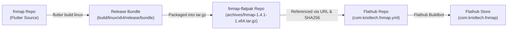

# Upgrading the fnmap Flatpak on Flathub

This step-by-step guide walks you through preparing, packaging, uploading, and releasing an updated version of **fnmap** (`com.krioltech.fnmap`) on [Flathub](https://flathub.org/apps/com.krioltech.fnmap).

---

## 1. Overview & Flathub Architecture

Flathub builds applications inside strictly isolated sandbox containers without general internet access during the compilation phase. Because Flutter requires internet access to download tools and package dependencies, **fnmap** uses Flathub's binary archive distribution method:



### Three Associated Repositories

| Repository | Purpose | URL |
| :--- | :--- | :--- |
| **`fnmap`** | Main Flutter source code | `git@github.com:gmckesey/fnmap.git` |
| **`fnmap-flatpak`** | Release tarball archives & release tags | `git@github.com:gmckesey/fnmap-flatpak.git` |
| **`flathub/com.krioltech.fnmap`** | Flathub manifest and buildbot configuration | `git@github.com:flathub/com.krioltech.fnmap.git` |

---

## 2. Release Context & Version Target

* **Current Flathub Version:** `1.3.4-1` (Runtime: `org.freedesktop.Platform` `25.08`)
* **New Target Version:** `1.4.1` (Tag / Build: `v1.4.1-1`)
* **Key Changes in v1.4.1:**
  * **Flatpak Host Permission Validation:** Probes host execution portal permissions and provides actionable guidance (`flatpak override`) if unpermitted when running privileged scans.
  * **Privileged Scans:** Supports Polkit/pkexec privileged scans (natively via Classic Snap, or locally via `flatpak override` in Flatpak).
  * **Theme & UI Improvements:** Dark/light mode theme refinements, raw output selection, and multi-resolution icons.
  * **AppStream Release Notes:** Updated metadata and release notes.

---

## 3. Step 1: Verify Version & AppStream Metadata

### 3.1 Check Application Version Constants
Confirm that version `1.4.1` is synchronized across the project:

1. **[pubspec.yaml](file:///home/gmckesey/Development/Local/StudioProjects/fnmap/pubspec.yaml)**:
   ```yaml
   version: 1.4.1+1
   ```
2. **[lib/constants.dart](file:///home/gmckesey/Development/Local/StudioProjects/fnmap/lib/constants.dart)**:
   ```dart
   int kConfigVersionMajor = 1;
   int kConfigVersionMinor = 4;
   int kConfigVersionPatch = 1;
   int kConfigVersionBuild = 1;
   ```

### 3.2 Update AppStream Metainfo
Check [flatpak/com.krioltech.fnmap.metainfo.xml](file:///home/gmckesey/Development/Local/StudioProjects/fnmap/flatpak/com.krioltech.fnmap.metainfo.xml) and ensure the `<releases>` block includes release notes for version `1.4.1`:

```xml
  <releases>
    <release version="1.4.1" date="2026-10-13">
      <description>
        <p>
          Version 1.4.1 adds Flatpak host execution permission validation with
          guidance for running privileged scans, and updates dependencies.
        </p>
      </description>
    </release>
    <release version="1.4.0" date="2026-10-13"/>
    <release version="1.3.4-1" date="2025-05-21"/>
  </releases>
```

Validate the metadata file using `appstreamcli`:

```bash
appstreamcli validate flatpak/com.krioltech.fnmap.metainfo.xml
```

---

## 4. Step 2: Build the Flutter Linux Release Bundle

From the root of the **`fnmap`** project directory, run a clean release build:

```bash
cd /home/gmckesey/Development/Local/StudioProjects/fnmap
flutter clean
flutter pub get
flutter build linux --release
```

Verify that the output bundle was created:

```bash
ls -la build/linux/x64/release/bundle/
```

*Expected output: Contains `fnmap` (executable), `data/` directory, and `lib/` directory.*

---

## 5. Step 3: Assemble the Flathub Release Archive

The Flathub manifest expects an archive with the top-level directory `fnmap-archive/` structured as follows:

```
fnmap-archive/
├── bin/
│   └── bundle/               # Full contents of build/linux/x64/release/bundle/
│       ├── fnmap
│       ├── data/
│       └── lib/
├── com.krioltech.fnmap.metainfo.xml
├── fnmap.desktop
└── icons/
    └── fnmap.png
```

### Option A: Using the Automated Packaging Script (Recommended)

Run [package-flatpak-archive.sh](file:///home/gmckesey/Development/Local/StudioProjects/fnmap/package-flatpak-archive.sh):

```bash
./package-flatpak-archive.sh
```

*This automatically detects the version from [pubspec.yaml](file:///home/gmckesey/Development/Local/StudioProjects/fnmap/pubspec.yaml) (`1.4.1-1`), stages all files into `fnmap-archive/`, creates `fnmap-1.4.1-1.x64.tar.gz`, calculates the SHA-256 checksum, and prints the exact Flathub YAML manifest block ready to copy and paste.*

**Available Flags:**
* `-b, --build`: Rebuilds the Flutter Linux release bundle (`flutter build linux --release`) before packaging.
* `-c, --clean`: Runs `flutter clean` and `flutter pub get` before building (implies `-b`).
* `-v, --version <ver>`: Explicitly overrides the version string (e.g. `./package-flatpak-archive.sh -v 1.4.1-1`).
* `-o, --output <dir>`: Sets custom output destination directory for the generated tarball.

---

### Option B: Manual Assembly

If you prefer to assemble the archive manually:

```bash
# 1. Prepare temporary packaging directory
rm -rf /tmp/fnmap-archive /tmp/fnmap-1.4.1-1.x64.tar.gz
mkdir -p /tmp/fnmap-archive/bin /tmp/fnmap-archive/icons

# 2. Copy the Flutter release bundle
cp -r build/linux/x64/release/bundle /tmp/fnmap-archive/bin/
chmod +x /tmp/fnmap-archive/bin/bundle/fnmap

# 3. Copy metainfo and icons
cp flatpak/com.krioltech.fnmap.metainfo.xml /tmp/fnmap-archive/
cp assets/fnmap.png /tmp/fnmap-archive/icons/

# 4. Copy desktop launcher
cp flatpak/com.krioltech.fnmap.desktop /tmp/fnmap-archive/fnmap.desktop

# 5. Compress into tar.gz
tar -czvf fnmap-1.4.1-1.x64.tar.gz -C /tmp fnmap-archive

# 6. Calculate SHA-256 checksum
sha256sum fnmap-1.4.1-1.x64.tar.gz
```

> [!IMPORTANT]
> **Copy the resulting 64-character hash.** You will need it in **Step 5** when updating `com.krioltech.fnmap.yml`.

---

## 6. Step 4: Upload the Archive to `fnmap-flatpak`

Clone or open your `fnmap-flatpak` repository:

```bash
# Clone if not already present locally
cd /home/gmckesey/Development/Local/StudioProjects
git clone git@github.com:gmckesey/fnmap-flatpak.git
cd fnmap-flatpak
git checkout main
git pull origin main
```

### 6.1 Copy Archive & Commit
```bash
cp /tmp/fnmap-1.4.1-1.x64.tar.gz archives/
git add archives/fnmap-1.4.1-1.x64.tar.gz
git commit -m "Add fnmap 1.4.1-1 release archive"
git push origin main
```

### 6.2 Tag the Release
Create and push the git tag `v1.4.1-1`:

```bash
git tag v1.4.1-1
git push origin v1.4.1-1
```

### 6.3 Verify URL Accessibility
Test that the raw GitHub download link resolves properly:

```bash
curl -I -s "https://github.com/gmckesey/fnmap-flatpak/raw/refs/tags/v1.4.1-1/archives/fnmap-1.4.1-1.x64.tar.gz" | head -n 5
```
*(Verify HTTP 302 Found or HTTP 200 OK)*

---

## 7. Step 5: Update the Flathub Manifest (`com.krioltech.fnmap.yml`)

Clone or open the official Flathub repository:

```bash
cd /home/gmckesey/Development/Local/StudioProjects
git clone git@github.com:flathub/com.krioltech.fnmap.git
cd com.krioltech.fnmap
git checkout master
git pull origin master
```

### 7.1 Create a Release Branch
```bash
git checkout -b v1.4.1-1
```

### 7.2 Update `com.krioltech.fnmap.yml`
Make two key changes to `com.krioltech.fnmap.yml`:

#### 1. Maintain Standard Sandboxed `finish-args`
Flathub enforces strict sandboxing rules via `flatpak-builder-lint`. Adding `--talk-name=org.freedesktop.Flatpak` triggers the blocking linter error:
```
'finish-args-flatpak-spawn-access' error found in linter manifest check.
Details: finish-args has access to flatpak-spawn
```
Because Flathub forbids sandbox escapes by default, keep your `finish-args` clean:

```yaml
finish-args:
  - --share=ipc
  - --socket=fallback-x11
  - --socket=wayland
  - --device=dri
  - --share=network
  - --filesystem=xdg-documents
```

> [!TIP]
> **Privileged Scans in Flatpak:** Standard unprivileged scans execute using the bundled `/app/bin/nmap`. For users wanting host-level privileged scans in Flatpak, they can grant the portal permission locally on their machine:
> ```bash
> flatpak override --user --talk-name=org.freedesktop.Flatpak com.krioltech.fnmap
> ```
> Alternatively, users needing privileged raw socket scans can install the **Classic Snap** (`sudo snap install fnmap --classic`) or native builds.

#### 2. Update the `fnmap` Module Source
Update the `url` to point to `v1.4.1-1` and paste the new `sha256` calculated in Step 3.2:

```diff
   - buildsystem: simple
     name: fnmap
     build-commands:
       - cp -R fnmap-archive/bin/bundle /app/fnmap
       - chmod +x /app/fnmap/fnmap
       - mkdir -p /app/bin/
       - ln -s /app/fnmap/fnmap /app/bin/fnmap
       - install -Dm644 fnmap-archive/com.krioltech.fnmap.metainfo.xml -t /app/share/metainfo/
       - install -Dm644 fnmap-archive/fnmap.desktop /app/share/applications/fnmap.desktop
       - install -Dm644 fnmap-archive/icons/fnmap.png /app/share/icons/hicolor/512x512/apps/com.krioltech.fnmap.png
     sources:
       - type: archive
-        url: https://github.com/gmckesey/fnmap-flatpak/raw/refs/tags/v1.3.4-1/archives/fnmap-1.3.4-1.x64.tar.gz
-        sha256: 65d48ea108c2ce9ceb629c9b1b35469d0f40d3929d91aeb794279546f65c313e
+        url: https://github.com/gmckesey/fnmap-flatpak/raw/refs/tags/v1.4.1-1/archives/fnmap-1.4.1-1.x64.tar.gz
+        sha256: <NEW_SHA256_HASH_FROM_STEP_3.2>
         dest: fnmap-archive
```

### 7.3 Commit the Changes
```bash
git add com.krioltech.fnmap.yml
git commit -m "Update fnmap to v1.4.1-1"
```

---

## 8. Step 6: (Optional) Local Build Test with `flatpak-builder`

If you have `flatpak-builder` installed and wish to test the Flathub recipe locally before pushing:

```bash
flatpak-builder --user --install --force-clean /tmp/fnmap-build-dir com.krioltech.fnmap.yml
```

Once built and installed, run the application:

```bash
flatpak run com.krioltech.fnmap
```

*Verify that **Help -> About** reports `1.4.1`.*

---

## 9. Step 7: Push Branch and Submit Pull Request to Flathub

### 9.1 Push the Branch to Flathub
From the `com.krioltech.fnmap` repository:

```bash
git push origin v1.4.1-1
```

### 9.2 Create the Pull Request
1. Open your browser and navigate to:
   [https://github.com/flathub/com.krioltech.fnmap/pulls](https://github.com/flathub/com.krioltech.fnmap/pulls)
2. Click **New Pull Request**.
3. Set **base:** `master` and **compare:** `v1.4.1-1`.
4. Title:
   ```
   Update to v1.4.1-1
   ```
5. Description:
   ```markdown
   Updates fnmap to v1.4.1-1:
   - Added Flatpak host portal permission check with actionable guidance for privileged scans
   - Updated dark and light theme palettes
   - Added raw scan output selection
   - Updated AppStream metainfo release notes
   ```
6. Click **Create pull request**.

---

## 10. Step 8: Monitor Flathub Buildbot & Merge

1. **Automated Test Build:**
   * Within 1–2 minutes, `@flathubbot` will trigger a build on Flathub's infrastructure and post a status comment on your PR.
   * If the build succeeds, `@flathubbot` provides a test install command:
     ```bash
     flatpak install --user https://dl.flathub.org/build-repo/<build-id>/com.krioltech.fnmap.flatpakref
     ```
2. **Review & Approval:**
   * Automated checks should now pass cleanly without linter warnings.
3. **Merge Pull Request:**
   * Click **Merge pull request** (or `gh pr merge`).
   * Once merged into `master`, Flathub automatically triggers the production publication build.

---

## 11. Step 9: Post-Release Verification

> [!NOTE]
> It takes roughly **15 to 45 minutes** for a merged build to be published across Flathub's global CDN and ostree repositories.

### 11.1 Check Flathub App Page
Visit [flathub.org/apps/com.krioltech.fnmap](https://flathub.org/apps/com.krioltech.fnmap) and verify the version shows `1.4.1`.

### 11.2 Check Remote Metadata
In your terminal, check the public Flathub ostree remote:

```bash
flatpak remote-info flathub com.krioltech.fnmap
```
*(Verify the `Version:` field displays `1.4.1`)*

### 11.3 Update and Smoke Test
Update your local Flatpak installation:

```bash
flatpak update com.krioltech.fnmap
```
Or install if not already installed:
```bash
flatpak install flathub com.krioltech.fnmap
```

Launch fnmap:
```bash
flatpak run com.krioltech.fnmap
```

#### Validation Checklist
- [ ] Open **Help -> About**: verify version displays `1.4.1`.
- [ ] Run an unprivileged scan (e.g. `nmap -F scanme.nmap.org`): verify built-in `/app/bin/nmap` executes.
- [ ] Run a **Privileged Scan** (`-sS` SYN stealth scan): verify the prompt or guidance works as expected.

---

## 12. Step 10: Cleanup Temporary Files

After publication is complete, remove local temporary packaging artifacts:

```bash
rm -rf /tmp/fnmap-archive /tmp/fnmap-1.4.1-1.x64.tar.gz /tmp/fnmap-build-dir
```

To clean local Flatpak build files in your Flutter workspace, run:
```bash
./clean-flatpak.sh
```
